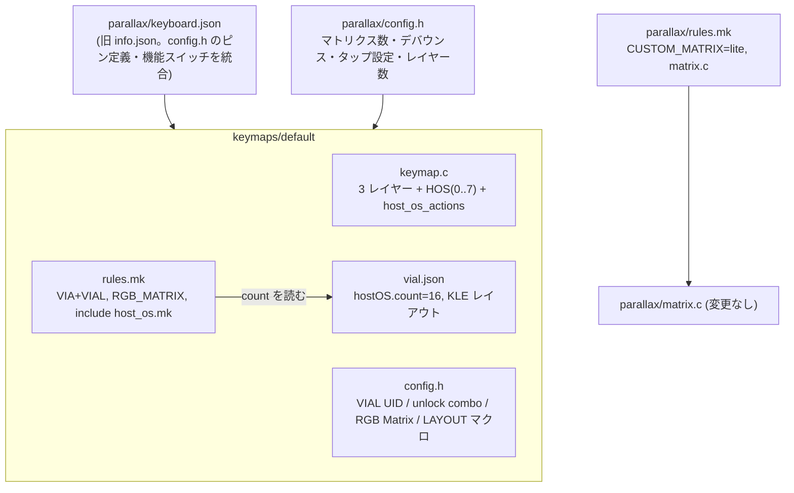
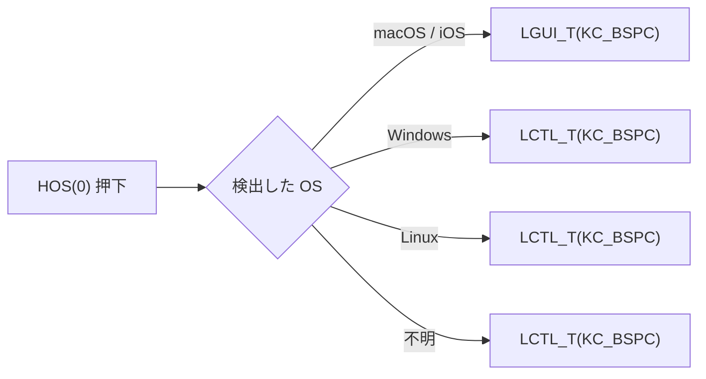
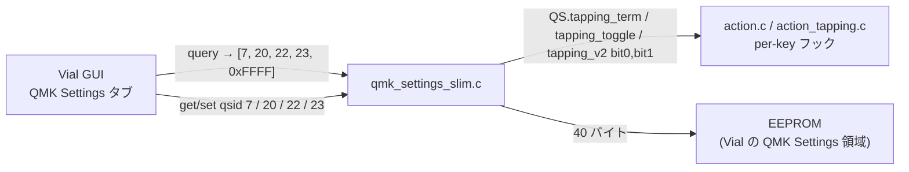

# TReK GT40Plus PARALLAX — Vial / HostOS 対応 仕様書

作成日: 2026-10-16

## 1. 目的

VIA 用に作られた PARALLAX のファームウェア（`rgbmatrix_win` / `rgbmatrix_mac` の 2 キーマップ）を、
**Vial + HostOS** の 1 キーマップ（`default`）に統合する。
OS ごとのキーの違いは HostOS（`HOS(n)`）で吸収し、Windows 用と Mac 用のファームを分けない。

## 2. 前提とハードウェア

| 項目 | 値 | 出典 |
|---|---|---|
| MCU / ブートローダ | ATmega32u4 / caterina | 旧 `info.json` |
| フラッシュ上限 | 28,672 バイト（caterina 4KB を除く） | QMK 既定 |
| EEPROM | 1,024 バイト → Vial のタップダンス枠は **8** | `quantum/vial.h` |
| マトリクス | 8 行 × 7 列（左右で `ROW2COL` / `COL2ROW` を混ぜた独自スキャン、`matrix.c`） | 旧 `config.h` |
| 行ピン / 列ピン | `D1 D0 D4 C6` / `F4 F5 F6 F7 B1 B3 B2` | 旧 `config.h` |
| エンコーダ | 3 個（A: `D7 B4 D2`、B: `E6 B5 B6`、分解能 4） | 旧 `config.h` |
| LED | WS2812 × 42（`D3`）、RGB Matrix | 旧 `info.json` / `g_led_config` |
| USB | VID `0x1209` / PID `0x516A` | 旧 `info.json`（変更しない） |
| デバウンス | 50ms、`sym_eager_pk` | 旧 `config.h` / `rules.mk` |

ピンとマトリクスは `trek/symmetria`（Vial 対応済みの 32u4 機）と同じなので、構成はそれに倣う。

## 3. ファイル構成（変更後）

旧ファイルの扱い（削除を伴うため、実施前にあらためて確認する）:

| ファイル | 扱い |
|---|---|
| `info.json` → `keyboard.json` | KLE の x が負だと QMK が JSON ごと無視するので x を +8.1 して 0 始まりにした。ピン定義・機能スイッチを統合し、確認のうえ `keyboard.json` に改名した（2026-10-16） |
| `keymaps/rgbmatrix_win/`、`keymaps/rgbmatrix_mac/`、旧 hex 2 つ | `default` に統合したうえで削除済み（2026-10-16） |
| `trek_parallax_rgbmatrix_{win,mac}.hex` | 新しい `trek_parallax_default.hex` に置き換え |

## 4. レイヤー

`DYNAMIC_KEYMAP_LAYER_COUNT 3`。元は 4 層だったが、Mac 配置固定の手動切り替え層（旧レイヤー 1、§5.2）を
削り、浮いた EEPROM 112 バイトをタップダンス枠（§5.1）に充てた。

| # | 名前 | 内容 |
|---|---|---|
| 0 | `_BASE` | 元の win/mac の共通部分 + `HOS(0)〜HOS(2)`、左親指外側は `HOS(7)`（旧 `TG(1)` の位置、既定は空） |
| 1 | `_RAISE` | 数字・カーソル・記号 + `HOS(3)〜HOS(6)`。`LT(1, KC_SPC)` |
| 2 | `_ADJUST` | F キー・RGB 操作（元と同じ）。`MO(2)` |

## 5. HostOS

### 5.1 割り当て

`vial.json` に `"hostOS": {"count": 16}` を書き、keymap の `config.h` で `VIAL_TAP_DANCE_ENTRIES 32` とする
（Vial の既定は EEPROM 1 KB だと 8 枠）。末尾 16 枠が HostOS、先頭 16 枠が通常のタップダンスで、RP2040 機と同じ内訳。
既定値を持つのは `HOS(0)〜HOS(6)` の 7 枠。`HOS(7)` は旧 `TG(1)` の位置に置いた空きキー、`HOS(8)〜HOS(15)` は予備。

EEPROM 1,024 バイトの内訳: ヘッダ 41、キーマップ 3 層 336、エンコーダ 36、QMK Settings 40、
タップダンス 32×10 = 320、Combo 4×10 = 40、残り（マクロ）211。Vial はマクロ用に 100 バイト以上を要求するため、
4 層のままでは 32 枠にできない（87 バイトで 13 バイト不足）。

元の win/mac の差分 7 か所を、次のとおり `HOS(n)` に置き換える。

| HOS | 位置 | macOS | Windows | Linux | Default |
|---|---|---|---|---|---|
| 0 | L0 左親指 BSPC | `LGUI_T(KC_BSPC)` | `LCTL_T(KC_BSPC)` | `LCTL_T(KC_BSPC)` | `LCTL_T(KC_BSPC)` |
| 1 | L0 右親指 ENT | `RGUI_T(KC_ENT)` | `RCTL_T(KC_ENT)` | `RCTL_T(KC_ENT)` | `RCTL_T(KC_ENT)` |
| 2 | L0 右親指 LANG1 | `RCTL_T(KC_LNG1)` | `RGUI_T(KC_LNG1)` | `RGUI_T(KC_LNG1)` | `RGUI_T(KC_LNG1)` |
| 3 | L2 `G` の位置 | （空） | `LGUI(KC_G)` | （空） | （空） |
| 4 | L2 `V` の位置 | （空） | `LGUI(KC_V)` | （空） | （空） |
| 5 | L2 `N` の位置 | `LGUI(KC_LBRC)` | `KC_WBAK` | `KC_WBAK` | `KC_WBAK` |
| 6 | L2 `M` の位置 | `LGUI(KC_RBRC)` | `KC_WFWD` | `KC_WFWD` | `KC_WFWD` |
| 7 | 予備 | — | — | — | — |

- HOS(3)/(4) の Win+G・Win+V は Windows 専用の機能なので、Linux とフォールバックは空にする（空なら何も送らない）。
- その他の Linux とフォールバックは Windows と同じにする（元の win 版の動作）。

### 5.2 旧レイヤー 1（TG(1)）の廃止

元の 2 キーマップでは、レイヤー 1 で「もう一方の OS のモディファイア配置」に切り替えられた。
HostOS では OS が自動で決まるためこの層は不要になり、タップダンス枠を 32 にする EEPROM を確保するために削った
（ユーザー指示）。OS 検出が外れたときは、Vial の HostOS タブで該当スロットの Default 欄を直すか、
`HOS(7)`（旧 `TG(1)` の位置）に任意のキーを割り当てて対処する。

## 6. Vial

| 項目 | 値 |
|---|---|
| `VIAL_KEYBOARD_UID` | 新しく生成した 8 バイト |
| アンロックコンボ | `[0,0]`（ESC）+ `[1,0]`（TAB） |
| `vial.json` の `matrix` | `rows: 8, cols: 7` |
| `vial.json` のレイアウト | `keyboard.json` の 51 キーの座標から KLE を作る。エンコーダ 3 個は CCW/CW を `e` ラベルで追加 |
| `lighting` | `none`（RGB Matrix は QMK 側のキーコードで操作。symmetria と同じ） |

## 7. RGB Matrix とフラッシュ容量

- `RGB_MATRIX_LED_COUNT` は 42（`g_led_config` の実数。元の win 版にあった 48 は誤り）。
- 最大輝度 200、既定の彩度 255（元の win 版の値）。
- フラッシュが 28,672 バイトに収まらないときは、`ENABLE_RGB_MATRIX_*` を次の順に削って収める。
  1. フレームバッファ系・重い効果（`DIGITAL_RAIN`、`TYPING_HEATMAP`、`PIXEL_*`、`*_MULTI*` 系）
  2. `BAND_*`、`CYCLE_*` 系の一部
  3. それでも収まらなければレビューで相談する
- 削った効果は `readme.md` に記載する。

### 7.1 実測結果（2026-10-16）

| 構成 | サイズ | 備考 |
|---|---|---|
| 全効果あり + Vial 既定機能 | 28,672 + 10,740 超過 | 不可 |
| 効果なし + Vial 既定機能 | 3,574 超過 | 効果を全部削っても足りない |
| 効果なし + QMK Settings / Combo / Key Override 無効 | 27,120（1,552 空き） | |
| さらに Caps Word / Layer Lock / Repeat Key 無効 | 24,540（4,132 空き） | ここを土台にする |
| 上記 + 効果 24 個 | 28,132（540 空き） | Combo なし版 |
| Combo を戻す（+約2,140） | 30,272（1,600 超過） | |
| Combo あり + 効果 11 個 | **28,280（392 空き）** | 採用（Combo を優先） |
| 上記 + QMK Settings（Auto Shift / Chordal Hold / キー別タッピング設定を含む） | 33,766（5,094 超過） | QMK Settings 単体で約 5.4 KB。不可 |
| RGB Matrix を完全に外し、Vial 全機能あり | 33,906（5,234 超過） | 照明を捨てても全機能は入らない |
| Combo あり + 縮小版 QMK Settings（§9） + 効果 11 個 | 29,196（524 超過） | 縮小版は約 916 バイト |
| 同上、テーブルなしの直書き版 + 効果 5 個 | 28,390（282 空き） | |
| 同上 + 効果 6 個（静止 2 / 動的 2 / キー反応 2） | 28,552（120 空き） | 4 層・タップダンス 8 枠 |
| 同上、動的を RAINBOW_MOVING_CHEVRON にした場合 | 28,584（88 空き） | |
| 同上、静止を ALPHAS_MODS にした場合 | 28,526（146 空き） | |
| 同上、キー反応を SOLID_SPLASH にした場合 | 超過 | SPLASH 系は約 180 バイト超 |
| 効果 6 個、4 層、タップダンス 16 枠（HostOS 8 + 通常 8） | 28,550（122 空き） | EEPROM マクロ 247 |
| 効果 6 個、4 層、タップダンス 24 枠（HostOS 16 + 通常 8） | 28,612（60 空き） | EEPROM マクロ 167 |
| 効果 6 個、4 層、タップダンス 32 枠 | ビルド不可 | EEPROM マクロ 87 < 100 |
| 効果 6 個、**3 層**、タップダンス 32 枠（HostOS 16 + 通常 16） | 28,522（150 空き） | 1 層分 112 バイトが Flash でも浮く。以前 28,494 と記録したのは生成ファイル未再生成の誤計測 |
| 同上、SOLID_REACTIVE → SOLID_REACTIVE_MULTINEXUS | 28,990（318 超過） | MULTINEXUS は SOLID_REACTIVE より約 460 バイト大きい |
| MULTINEXUS + SIMPLE + GRADIENT_UP_DOWN + CYCLE_LEFT_RIGHT | 28,734（62 超過） | Grave Esc を外せば 28,568（104 空き）だが、40% 配列のため Grave Esc は必須（ユーザー指示）。不採用 |
| MULTINEXUS + SIMPLE + GRADIENT_UP_DOWN | 28,522（150 空き） | 一時採用。動的効果なし |
| SOLID_SPLASH + SPLASH + GRADIENT_UP_DOWN | 28,262（410 空き） | ユーザー指示。SPLASH 2 個は MULTINEXUS + SIMPLE より 260 バイト小さい |
| 上記 + 縮小版 QMK Settings を 4 項目に拡張（§9） | 28,458（214 空き） | 4 項目で +196 バイト |
| 上記 + BREATHING | 28,728（56 超過） | BREATHING は sin テーブルと時間ランナーを伴い約 270 バイト。CYCLE_ALL なら 44 空き、CYCLE_LEFT_RIGHT なら 16 空き |
| 上記 + BREATHING、縮小版 QMK Settings の EEPROM 入出力を切り詰め | **28,622（50 空き）** | 採用（ユーザー指示）。切り詰めで −106 バイト |
| 縮小版 QMK Settings の方式比較（MULTINEXUS 構成で計測） | | 直書き 4 項目: 48 超過 / PROGMEM テーブル 4 項目: 140 超過 / Retro tapping 追加: さらに +230 |
| VialRGB（Vial GUI に照明タブ）を追加 | 28,984（312 超過） | 約 460 バイト。不可 |

注: リンカの「overflowed by N」は 32 KB（32,768）基準。caterina の上限 28,672 との差 4,096 を足して読む。
その他の実測: Combo ≒ 2,140、Caps Word + Layer Lock + Repeat Key ≒ 2,580、Mouse keys ≒ 1,740、
`NO_ACTION_ONESHOT` ≒ 1,140、`sym_defer_g` デバウンス ≒ 890（50 ms の遅延が乗る）、`VIAL_INSECURE` ≒ 280、Grave Esc ≒ 160。

採用した効果（4）:
- 静止: GRADIENT_UP_DOWN（+ 常設の SOLID_COLOR）
- 動的: BREATHING
- キー反応: SOLID_SPLASH, SPLASH

効果 1 個は約 110〜130 バイト（SOLID_REACTIVE 系の単純なものは共通ランナーを共有）。波紋系（SPLASH / MULTINEXUS）は
共通の波紋ランナー（約 400 バイト）を 1 回だけ払い、2 個目以降は約 100 バイト。MULTINEXUS は多点追跡ぶんさらに大きい。キー反応効果は待機中は消灯し、押したキーだけが光って減衰する。
`vial.json` は `"lighting": "none"` のため Vial GUI に照明タブは出ず、効果の切り替えはレイヤー 2 の `RGB_MOD` で行う
（RGB_MOD の順: SOLID_COLOR → GRADIENT_UP_DOWN → BREATHING → SPLASH → SOLID_SPLASH）。

タップダンス / HostOS の数を変えても Flash はほぼ変わらない（枠数は EEPROM の話で、`host_os_actions` は 1 件 8 バイト）ため、
Combo のぶんは効果の削減だけで捻出した。Combo の枠は EEPROM 1 KB のため 4 件。

無効にした Vial 機能（keymap の `rules.mk`）: `QMK_SETTINGS`（§9 の縮小版で代替）, `KEY_OVERRIDE_ENABLE`,
`CAPS_WORD_ENABLE`, `LAYER_LOCK_ENABLE`, `REPEAT_KEY_ENABLE`（HostOS が使うタップダンスは有効のまま）。

## 8. 受け入れ条件（テスト）

自動テスト: `parallax/tests/test_vial_hostos.py`

| # | 条件 | 種別 |
|---|---|---|
| T1 | `keyboard.json` があり `info.json` は残っておらず、32u4 / caterina / VID・PID・ピンが元と同じ | 静的 |
| T2 | キーボード定義 JSON のレイアウトが元の 51 キーと同じマトリクス位置を持つ | 静的 |
| T3 | `vial.json` が `hostOS.count = 8`、`matrix 8×7` で、レイアウト内のキー位置の集合が T2 と一致し、エンコーダが 3 個 | 静的 |
| T4 | keymap の `rules.mk` に `VIAL_ENABLE = yes` と `include quantum/host_os/host_os.mk` がある | 静的 |
| T5 | `keymap.c` が `host_os.h` を読み込み、`HOS(0)`〜`HOS(6)` を使い、`host_os_actions` に §5.1 の既定値がある | 静的 |
| T6 | `config.h` に `VIAL_KEYBOARD_UID` とアンロックコンボがある | 静的 |
| T7 | `qmk compile -kb trek/parallax -km default` が成功する | ビルド |
| T8 | 生成した `.hex` のサイズが 28,672 バイト以下 | ビルド |

手動確認（実機）:

| # | 条件 |
|---|---|
| M1 | Vial で認識され、キーマップとエンコーダが編集できる |
| M2 | HostOS 対応の Vial GUI で HostOS タブに 16 件、Tap Dance タブに 16 件が出る |
| M3 | Mac では左親指が Cmd、Windows では Ctrl になる（HOS(0)） |
| M4 | 全キーと 3 個のエンコーダが反応する |
| M5 | LED が点灯し、RGB 操作キーが効く |

## 9. 縮小版 QMK Settings（タップホールド 4 項目）

Vial 標準の QMK Settings（`quantum/qmk_settings.c`）は Auto Shift・Chordal Hold・キー別タッピングフックを
強制的に有効にするため約 5.4 KB あり、この MCU には入らない。そこで **Vial 本体を一切変更せず**、
keymap 内の `qmk_settings_slim.c` で同じプロトコル（query / get / set / reset）を実装し、
公開する設定を次の **タップホールド 4 項目**に絞る。

| qsid | 設定 | 既定値 | 読み手 |
|---|---|---|---|
| 7 | Tapping term | TAPPING_TERM（200 ms） | `vial.c` → `qs_get_tapping_term()` |
| 20 | Tapping toggle | TAPPING_TOGGLE（5） | `action.c` の `QS_tapping_toggle` |
| 22 | Permissive hold | OFF | `action_tapping.c` → `get_permissive_hold()`（`PERMISSIVE_HOLD_PER_KEY`） |
| 23 | Hold on other key press | ON | `action_tapping.c` → `get_hold_on_other_key_press()`（`HOLD_ON_OTHER_KEY_PRESS_PER_KEY`） |

Retro tapping（qsid 24）は `action.c` の本体コードだけで約 230 バイルかかるため見送った。

| 項目 | 内容 |
|---|---|
| `rules.mk` | `QMK_SETTINGS = no`（標準版を外す）、`OPT_DEFS += -DQMK_SETTINGS -DHOLD_ON_OTHER_KEY_PRESS_PER_KEY -DPERMISSIVE_HOLD_PER_KEY -DQS_SLIM_TAPPING_TOGGLE`、`SRC += qmk_settings_slim.c` |
| 公開設定 | qsid 7 / 20 / 22 / 23。GUI は query の結果に含まれる設定だけを表示する想定（実機で要確認: M6） |
| 既定値 | EEPROM リセット時に `tapping_v2` は bit1 のみ（Hold on other key press ON、Permissive hold OFF）、`tapping_term` と `tapping_toggle` はコンパイル時の値。他の QS フィールドもコンパイル時既定値を入れ、ほかのモジュール（Grave Esc、One-shot、Mouse keys、Tap 遅延）の挙動を変えない |
| EEPROM | 標準版と同じ 40 バイトの領域を使う（`qmk_settings_t` のサイズに固定）。書き込みは `store(offset, size)` 1 本で、比較ループは持たない（下層の `eeprom_update_byte` が未変更バイトを飛ばす） |
| コスト | 約 880 バイト（1 項目版 790 + 4 項目化 196 − EEPROM 入出力の切り詰め 106）。PROGMEM テーブル方式は直書きより約 290 バイト大きく不採用 |
| テスト | T9（静的）: rules.mk の配線（Retro tapping なし）、qsid が 7/20/22/23 だけ、テーブルなし、既定値、必要なフックの存在 |

手動確認に M6 を追加: Vial GUI の QMK Settings タブに Tapping term / Tapping toggle / Permissive hold /
Hold on other key press の 4 件だけが表示され、Hold on other key press を OFF にすると Mod-Tap の挙動が変わり、
Tapping term を変えると判定時間が変わり、再接続後も保持される。
