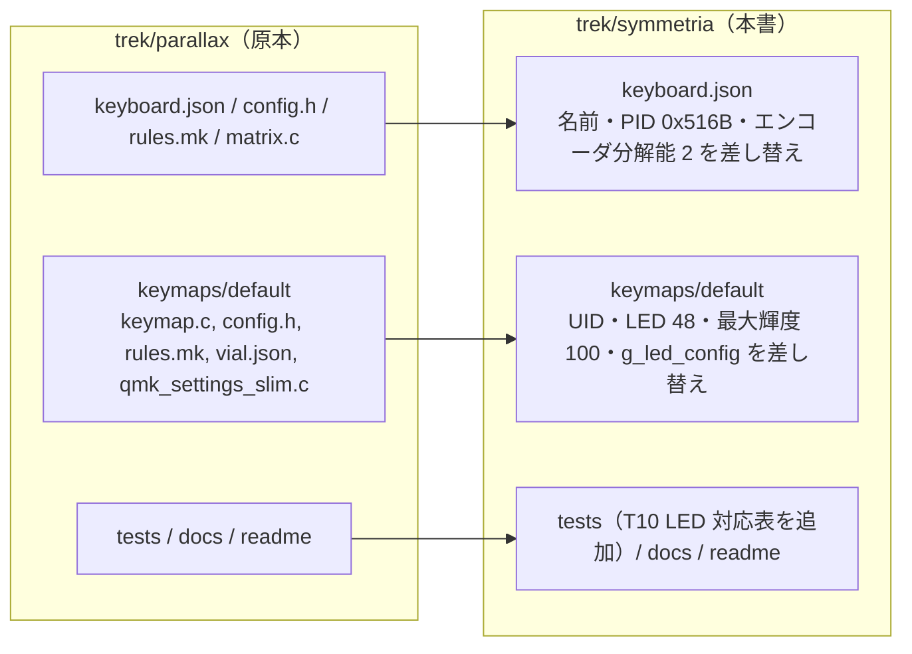

# TReK Symmetria — Vial + HostOS 化 仕様書

作成日: 2026-10-17

## 1. 目的

TReK Symmetria の Vial ファームウェアを、兄弟機 [TReK GT40Plus PARALLAX](../../parallax/docs/vial-hostos-spec.md)
と**同じ構成**で作り直す（ユーザー指示）。両機は PCB のマトリクス・エンコーダ・配列が同一で、LED だけが異なる
（PARALLAX は左右外側の親指キーに LED がなく 42 個、Symmetria はフルキーバックライトで 48 個）。

既存の Symmetria ファームウェアは VIA 時代の 6 層構成（OS 検出 + 手動 OS 層）で、`keyboard.json` のレイアウトが
壊れており（57 エントリ、重複・存在しない行 8 を含む）ビルドできなかった。

## 2. 構成

| 項目 | PARALLAX | Symmetria | 備考 |
|---|---|---|---|
| USB PID | 0x516A | **0x516B** | VID 0x1209 共通 |
| keyboard_name | TReK GT40Plus PARALLAX | TReK Symmetria | 既存の名前を維持 |
| Vial UID | 8A 09 6D C7 31 25 3E 29 | **37 D3 35 C7 90 F0 C9 D1** | 既存の UID を維持（Vial が別機として扱う） |
| LED 数 | 42 | **48** | `g_led_config` は既存 Symmetria ファームのものをそのまま使用 |
| LED のないキー | 左右モディファイア 6 個（行 0〜2 の列 0、行 4〜6 の列 6）+ 外側親指 3 個 = 9 | 外側親指 3 個（3,0）（3,6）（7,6）のみ | T10 で検証 |
| RGB_MATRIX_MAXIMUM_BRIGHTNESS | 200 | **100** | 48 個を USB 給電で点けるため、既存 Symmetria の値を維持 |
| エンコーダ分解能 | 4 | **2** | 既存 Symmetria の keyboard.json の値を維持（要実機確認） |
| Bootmagic | なし | なし | 既存 Symmetria は有効だったが Flash（50 バイト前後の空き）に入らない。QK_BOOT で代用 |
| それ以外 | — | 同一 | 3 層、HostOS 16 + タップダンス 16、Combo 4、縮小版 QMK Settings 4 項目、RGB 効果 4 個、Grave Esc |

## 3. キーマップ

PARALLAX の `keymap.c` をそのまま使う（`HOS(0)〜HOS(7)` の配置と既定値も同じ）。
既存 Symmetria の配列（右上 `P` / `BSPC`、親指 `LALT` / `LGUI_T(LNG2)` など）とは異なるため、
旧配列に戻したい場合は Vial GUI で編集する。

## 4. Flash

| 構成 | text+data | 空き |
|---|---|---|
| PARALLAX 同構成（2026-10-17） | 28,622 | 50 |
| Symmetria（LED 48、本書） | **28,620** | 52 |

LED 6 個分は `g_led_config` の PROGMEM（+18 バイト）と RAM の送信バッファ（+18 バイト）だけで、
LED 数に依存しないコードが大半のため Flash はほぼ同じ。

## 5. テスト

`keyboards/trek/symmetria/tests/test_vial_hostos.py`（PARALLAX の T1〜T9 を Symmetria 向けにパラメータ化 + T10）。

| # | 内容 | 種別 |
|---|---|---|
| T1〜T9 | PARALLAX と同じ（PID 0x516B、UID、LED 48、hex 名が Symmetria 用） | 静的 / ビルド |
| T10 | `g_led_config` の行列→LED 対応表が 8×7 で、LED 0〜47 がちょうど 1 回ずつ現れ、LED なしのキーが外側親指 3 個だけ | 静的 |

実行: `SYMMETRIA_BUILD=1 python3 -I keyboards/trek/symmetria/tests/test_vial_hostos.py`

## 6. 実機確認（PARALLAX の M1〜M6 に加えて）

| # | 内容 |
|---|---|
| M7 | 48 個すべてのキーが SPLASH で押下に反応する（親指中央 3 個ずつを含む） |
| M8 | エンコーダ 1 クリックで 1 回だけキーが出る（分解能 2 が正しいか。倍出るなら 4 に変更） |

## 7. 残置ファイル

`kle.json`（旧レイアウト図）と `.DS_Store` はそのまま。削除する場合は別途確認する。
